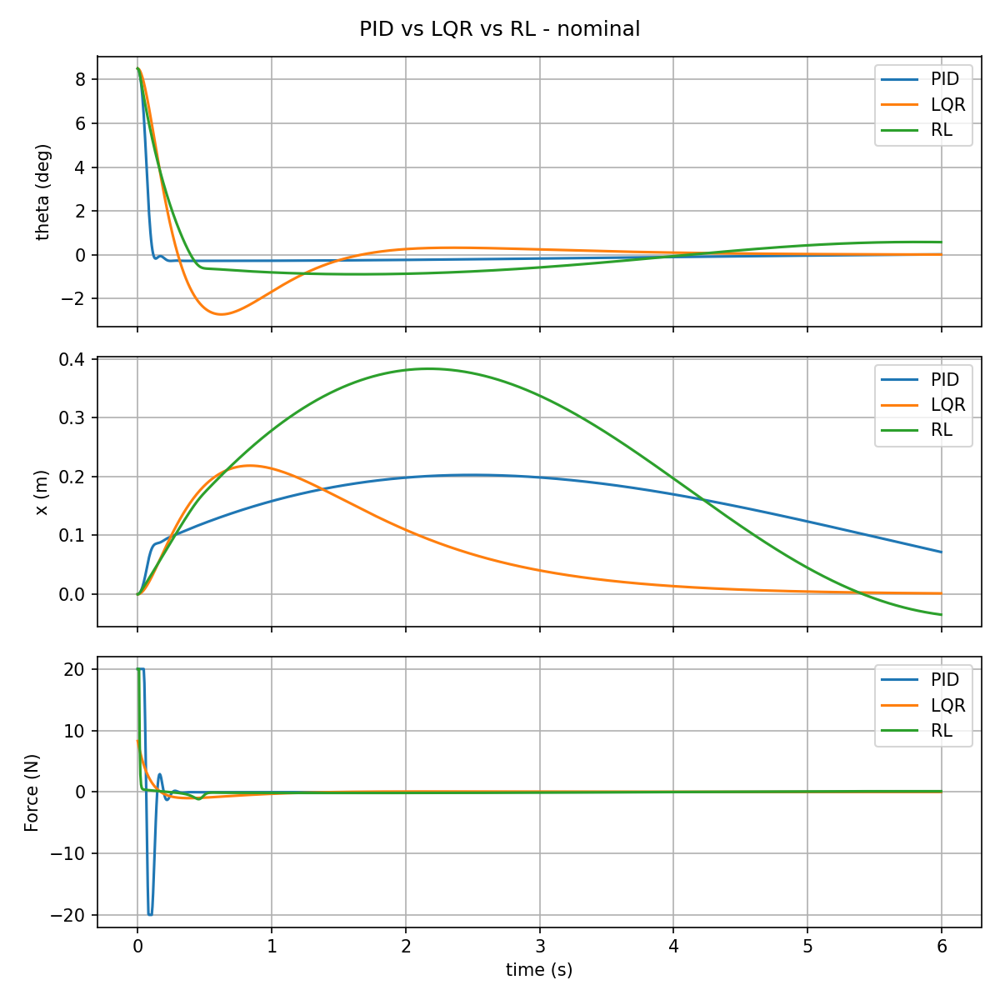
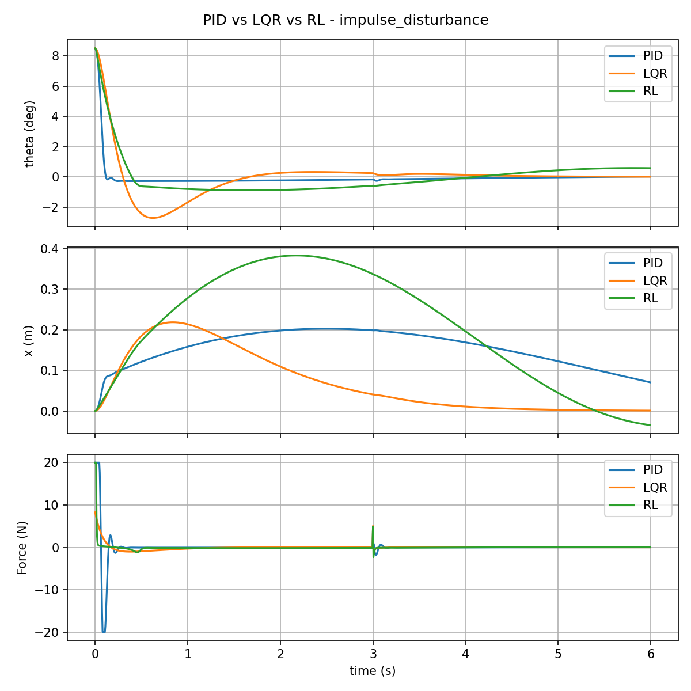
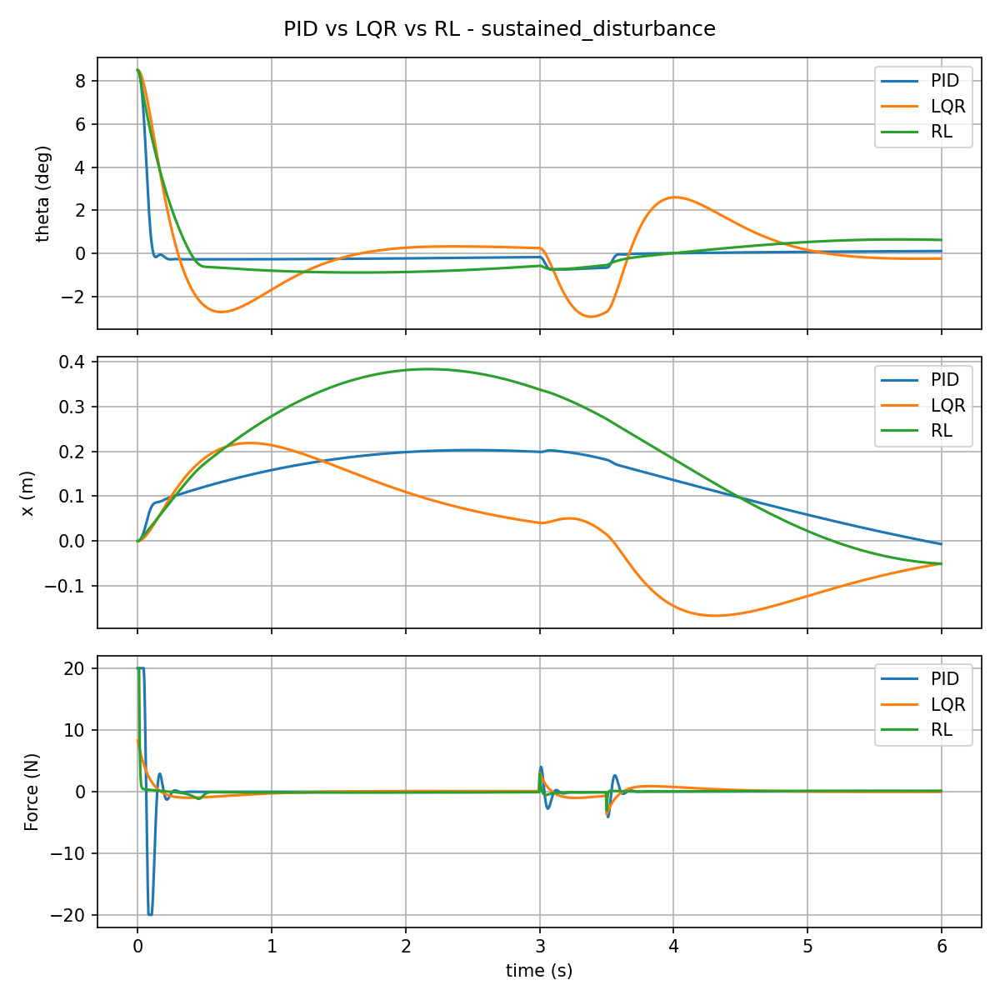

# Subtask 4 — Inverted Pendulum: PID vs LQR vs RL

## 1. Problem statement

The task asks for:

- A mathematical/dynamic model of the inverted pendulum
- A PID implementation **with tuning methodology**
- An LQR implementation **with design methodology**
- An RL implementation **with training methodology**
- A common benchmark environment and test scenarios
- Comparative plots/tables for all three controllers
- Reproducible code

Evaluated on: stabilisation success, settling time, rise time, overshoot,
steady-state error, control effort, disturbance rejection, robustness to
model/parameter uncertainty, fairness/reproducibility of the comparison, and
**technical justification of every design/tuning choice**. This README is
that justification — every non-obvious decision below is stated with the
reasoning behind it, not just the final number.

**Decisions made at the outset, and why:**

- **Cart-pole, not a rotary pendulum** — matches the problem statement's own
  expected-baseline description.
- **Python, not MATLAB/Simulink** — I know MATLAB, but Python keeps PID, LQR
  and RL in one reproducible stack (NumPy/SciPy for the plant and classical
  controllers, Gymnasium + Stable-Baselines3/PyTorch for RL) that an
  evaluator can run end to end.
- **RL is documented including its failures, not just the final version** —
  a controller that doesn't fully work, with a clear diagnosis of *why*, is
  more defensible in a viva than a suspiciously perfect number.

## 2. System description and mathematical model

- State vector: $s = [x, \dot{x}, \theta, \dot\theta]^T$, input
  $u = F$ (horizontal cart force), $\theta = 0$ at the upright equilibrium.
- Parameters: $M$ (cart mass), $m$ (pendulum point mass), $l$ (pivot-to-mass
  length), $g$ (gravity).
- **Decision:** I derived the equations of motion myself via Euler-Lagrange
  (kinetic energy of cart + pendulum point mass, potential energy
  $mgl\cos\theta$) rather than taking them from a source, specifically so I
  can defend the derivation directly rather than saying "the equations are
  well known."

**Coupled nonlinear equations of motion:**

$$(M + m)\ddot{x} + ml\ddot{\theta}\cos\theta - ml\dot{\theta}^2\sin\theta = F$$

$$l\ddot{\theta} + \ddot{x}\cos\theta - g\sin\theta = 0$$

**Solved explicitly for the accelerations** (the form actually integrated in
`dynamics.py`):

$$\ddot{x} = \frac{F + m\sin\theta\left(l\dot\theta^2 - g\cos\theta\right)}{M + m\sin^2\theta}$$

$$\ddot{\theta} = \frac{g\sin\theta - \ddot{x}\cos\theta}{l}$$

- **Decision:** integrate with 4th-order Runge-Kutta (`rk4_step`), not
  Euler — better accuracy at a timestep of $dt = 0.005$ seconds without
  needing a smaller step size.

**Linearization about the upright equilibrium** ($\theta, \dot\theta \to 0$,
$\sin\theta \approx \theta$, $\cos\theta \approx 1$, $\sin^2\theta \approx 0$)
— used **only** for LQR design; the nonlinear model above remains the
ground-truth plant for every simulation, including LQR's own evaluation.

$$
A =
\begin{bmatrix}
0 & 1 & 0 & 0 \\
0 & 0 & -mg/M & 0 \\
0 & 0 & 0 & 1 \\
0 & 0 & (M+m)g/(Ml) & 0
\end{bmatrix}
$$

$$
B =
\begin{bmatrix}
0 \\
1/M \\
0 \\
-1/(Ml)
\end{bmatrix}
$$

### 2.1 Validating the linearization before trusting it for LQR

- **Decision:** rather than asserting "small angles are a valid
  approximation," I quantified it (`validate_linearization.py`) with two
  checks:
  - An **instantaneous** acceleration-mismatch check — isolates the modeling
    error from the small-angle approximation itself, before the unstable
    dynamics have time to diverge.
  - A **short-horizon (0.05 second)** free-response trajectory check.

| Initial angle | Instantaneous angular-acceleration error | Max trajectory error (0.05s) |
|---|---|---|
| 1 deg | 0.01% | 0.0000 deg |
| 2 deg | 0.03% | 0.0000 deg |
| 5 deg | 0.20% | 0.0003 deg |
| 10 deg | 0.81% | 0.0022 deg |
| 20 deg | 3.25% | 0.0174 deg |
| 40 deg | 13.10% | 0.1272 deg |

- **Why this matters:** it gives a quantitative breakdown point instead of a
  hand-wave, and directly feeds the "robustness to model uncertainty"
  evaluation criterion — the linearization is trustworthy in the regime LQR
  actually operates in (small deviations from upright).

## 3. Controller design and tuning methodology

- **Decision:** all three controllers expose the identical interface
  `compute(state, x_ref, dt) -> force`, evaluated through one shared harness
  (`simulation.py`) against the identical nonlinear plant — this is what
  makes the three-way comparison fair rather than three separate demos.

### 3.1 PID — cascaded architecture, systematically tuned

- **Architecture decision:** outer loop maps cart-position error to a
  desired tilt angle (clamped to ±6 degrees); inner loop maps tilt-angle
  error to force (`controllers/pid.py`). Cascaded rather than a single SISO
  loop, since the plant has two coupled objectives (angle *and* position).
- **Sign-convention decision (non-obvious, worth stating explicitly):** from
  the equations of motion, $\ddot\theta = a\theta - bu$ with $a, b > 0$. To
  stabilize, the inner loop's proportional gain must satisfy
  $K_{p,\text{angle}} > (M+m)g$ (approximately 10.79 for my nominal parameters) or
  the restoring-force sign is simply wrong. This is a **plant-physics
  constraint**, not an arbitrary tuning choice — I encoded it directly as the
  tuning search's lower bound rather than discovering it by trial and error.
- **Tuning-method decision:** gains were optimized with **differential
  evolution** (a global, derivative-free optimizer) against a fixed
  objective defined *before* looking at any result, rather than hand-picked:

$$\text{cost} = 1.0 \cdot t_s + 0.05 \cdot OS + 2.0 \cdot SSE + 0.0005 \cdot J_u$$

  where $t_s$ is settling time in seconds, $OS$ is overshoot in percent,
  $SSE$ is steady-state error in degrees, and $J_u$ is control effort (with
  $t_s$ replaced by $50 + SSE$ when the run never settles, to push the
  search toward stabilizing gains first).

- **Why these weights, in this order:** settling first (a controller that
  doesn't stabilize is worthless regardless of anything else), then accuracy,
  then overshoot, then effort — stated here so it can't be second-guessed as
  reverse-engineered from the result.
- **Search bounds and why:** outer $K_p\in[0,0.5]$, $K_i\in[0,0.2]$,
  $K_d\in[0,0.5]$; inner $K_p\in[15,300]$ (lower bound set by the physics
  constraint above), $K_i\in[0,20]$, $K_d\in[0,60]$.
- **Honesty about the optimization itself:** two early tuning attempts
  converged to a mediocre local optimum (cost plateaued around 6.5–8.9); a
  third attempt with a larger population and a different seed converged
  properly. A global optimizer not finding the global optimum on the first
  try is a real methodological point, not something to hide.
- **Result** (initial tilt 8.5 degrees, full 6-second horizon): settling
  time 0.105s, overshoot 3.3%, steady-state error 0.014 degrees.

### 3.2 LQR — CARE-based, from the linearized model

- **Design decision:** solve the continuous-time algebraic Riccati equation
  (`scipy.linalg.solve_continuous_are`) for gain $K$ from $A$, $B$ above,
  then apply full-state feedback $u = -K(s - s_{\text{target}})$,
  where $s_{\text{target}} = [x_{\text{ref}}, 0, 0, 0]$.
- **Weighting decision:** $Q = \text{diag}(1, 1, 10, 1)$ — angle error penalized 10
  times more heavily than position/velocity errors, since stabilising
  $\theta$ is the primary objective; $R = [0.05]$ — a modest effort penalty.
- **Why I didn't hand-tune LQR:** the gain is the *unique* solution of the
  Riccati equation for a given $Q$, $R$ — the actual design choice is just
  those two matrices, not six independently-tuned numbers like PID. This is
  the methodological strength of LQR I want to be explicit about.

### 3.3 RL (PPO) — environment, reward design, and a documented ablation

- **Environment decision:** Gymnasium wrapper around the *exact same*
  `nonlinear_dynamics`/`rk4_step` PID and LQR use — not a separate/simplified
  physics model (`rl_env.py`).
- **Observation decision:** $[x - x_{\text{ref}},\ \dot{x},\ \theta,\ \dot\theta]$ —
  reference-aware, so RL solves the same problem PID/LQR solve, not a
  fixed-origin-only problem.
- **Action decision:** normalized to the range $[-1, 1]$, scaled to ±20
  Newtons inside the environment (standard practice, keeps PPO's gradients
  well-scaled).
- **Training-distribution decision:** randomize only the initial condition
  per episode ($\theta_0$ within ±0.15 rad, $x_0$ within ±0.05 m, $x_{\text{ref}}$
  within ±0.2 m) — no disturbances, no parameter variation. I return to why
  this matters in Section 6.
- **Algorithm decision:** PPO (Stable-Baselines3), `MlpPolicy` — a standard,
  well-supported continuous-control baseline.

**Three trained versions, documented including the failures — the
progression itself is the useful evidence:**

- **v1** — 200k timesteps, raw reward
  $-(\theta^2 + 0.05(x-x_{\text{ref}})^2 + 0.001u^2)$ in physical Newtons, no
  observation normalization.
  - *Result:* never settled reliably, even in the plain nominal case.
- **v2** — 500k timesteps, added `VecNormalize`, same reward.
  - *Result:* settled, but slowly/imprecisely (steady-state error 0.363 deg
    vs PID's 0.014 deg), very low control effort (max force 2.73N), and
    collapsed under the sustained disturbance and most of the IC sweep.
  - **Diagnosis (a real scale bug, not just a weak coefficient):** near the
    failure boundary ($\theta$ approximately 0.42 rad, $u$ up to 20N), the
    effort penalty ($0.001u^2$, max 0.4) could numerically **outweigh** the
    angle penalty ($\theta^2$, max approximately 0.175) — the policy had a
    genuine incentive to minimize force over correcting the angle.
- **v3** — same 500k timesteps, **same training distribution as v2** (only
  the reward changed, to isolate that one variable):

$$r = -\left(10\theta^2 + 0.1\dot\theta^2 + 0.5(x-x_{\text{ref}})^2 + 0.05\dot{x}^2 + 0.01a^2\right) - 100 \cdot \mathbb{1}_{\text{fail}}$$

  - **What changed and why:** penalizes the *normalized* action $a$ instead
    of raw Newtons (decouples the penalty from the force limit's scale),
    adds explicit angular/linear velocity damping terms, raises the failure
    penalty from 20 to 100.
  - **Weight priority, fixed before training, not adjusted afterward to
    chase a better number:** angle stability > position tracking > control
    effort.
  - *Result:* see Section 5 — transient quality improved substantially,
    region-of-attraction problem did not fully resolve.
- **Why v2 to v3 is a real ablation:** same plant, same algorithm, same
  training distribution, same evaluation protocol — only the reward changed.
  That isolation is what makes the comparison in Section 6 interpretable.

## 4. Common benchmark methodology

- **Fairness decision:** `simulation.py`'s `simulate()` is the single harness
  every controller runs through — same nonlinear plant, same RK4 integrator,
  same timestep, same actuator limit (±20N), same initial condition and
  same disturbance for whichever controller is under test.

**Metric definitions** (stated precisely so no term is ambiguous to an
evaluator):

- **Settling time** — earliest time after which the response stays inside
  the tolerance band (whichever is larger of 2% of the initial angle, or 0.5
  degrees) for the *remainder* of the run — not just the first moment it
  briefly dips inside.
  - *Bug found and fixed:* my first implementation only checked the first
    crossing, so a response that overshot back out of the band later was
    still (wrongly) marked "settled." Caught by testing, fixed before
    reporting any numbers.
- **`decay_time_90_to_10_s`** — time from first crossing 90% of the initial
  angular offset down to first crossing 10% of it:
  $t_{90\to10} = t(|\theta| = 0.1|\theta_0|) - t(|\theta| = 0.9|\theta_0|)$.
  - **Decision:** deliberately **not** called "rise time" — the conventional
    rise-time definition is for a step response rising toward a nonzero
    setpoint, not a regulation/decay response falling toward zero. Using the
    correct name avoids an evaluator flagging the terminology.
- **Overshoot** — largest excursion to the opposite sign of the initial
  tilt, as a percentage of the initial tilt.
- **Steady-state error** — mean $|\theta|$ over the last 1 second of the run.
- **Control effort** — $J_u = \int u^2\ dt$ over the run.
- **Max control force** — largest $|u|$ used, for checking actuator
  saturation.

**Test scenarios**, all at an initial tilt of 8.5 degrees unless stated, and
why each one is included:

- **Nominal** — no disturbance, 6-second horizon — the baseline case.
- **Impulse disturbance** — a single-timestep +5N force at t = 3s — tests
  instantaneous shock rejection.
- **Sustained disturbance** — a +3N force held from t = 3.0s to t = 3.5s —
  tests rejection of a disturbance that doesn't vanish immediately.
- **Initial-condition sweep** — initial tilt in {2, 5, 8.5, 10, 12, 15, 20}
  degrees, no disturbance — reveals *where* each controller's stabilization
  fails, not just how fast it is in one single case.
- **Parameter uncertainty** — 15 trials, with $M$, $m$, $l$ each
  independently perturbed by up to ±15%, while every controller's
  gains/policy are computed **once**, at nominal parameters, and never
  redesigned per trial.
  - **Why not redesign per trial:** that would test "can I retune for a
    known plant," which is trivial; testing a *fixed* controller against
    plant uncertainty is the actually meaningful robustness question — does
    a controller designed for the nominal robot still work when the real
    robot isn't exactly nominal.

## 5. Results

### 5.1 Nominal (initial tilt 8.5 degrees)

| Metric | PID | LQR | RL (v3) |
|---|---|---|---|
| Settling time | 0.105 s | 1.380 s | FAIL (nan) |
| Decay time (90 to 10%) | 0.070 s | 0.210 s | 0.295 s |
| Overshoot | 3.28% | 32.01% | 10.45% |
| Steady-state error | 0.014 deg | 0.021 deg | 0.543 deg |
| Control effort | 41.33 | 2.98 | 6.54 |
| Max force | 20 N | 8.28 N | 20 N |



### 5.2 Impulse disturbance (+5N at t=3s)

| Metric | PID | LQR | RL (v3) |
|---|---|---|---|
| Settling time | 0.105 s | 1.380 s | FAIL (nan) |
| Overshoot | 3.28% | 32.01% | 10.45% |
| Steady-state error | 0.014 deg | 0.017 deg | 0.544 deg |
| Control effort | 41.55 | 3.11 | 6.71 |



### 5.3 Sustained disturbance (+3N, t=3.0 to 3.5s)

| Metric | PID | LQR | RL (v3) |
|---|---|---|---|
| Settling time | 3.530 s | 4.800 s | FAIL (nan) |
| Overshoot | 8.91% | 34.57% | 10.45% |
| Steady-state error | 0.091 deg | 0.175 deg | 0.616 deg |
| Control effort | 42.49 | 4.25 | 6.68 |



- Both PID and LQR recover without difficulty.
- RL does not diverge catastrophically here (an earlier v2 run did — see
  Section 6), but does not satisfy the settling criterion either.

### 5.4 Initial-condition sweep

| Initial tilt | PID | LQR | RL (v3) |
|---|---|---|---|
| 2 deg | 0.05 s | 0.88 s | **0.23 s** |
| 5 deg | 0.08 s | 1.25 s | **0.32 s** |
| 8.5 deg | 0.10 s | 1.38 s | FAIL |
| 10 deg | 0.12 s | 1.42 s | FAIL |
| 12 deg | 0.19 s | 1.45 s | FAIL |
| 15 deg | 2.35 s | 2.81 s | FAIL |
| 20 deg | 3.64 s | 3.25 s | FAIL |

- PID is **not** universally faster than LQR — at 20 degrees, LQR settles
  faster (3.25s vs 3.64s).
- RL beats both classical controllers at 2 and 5 degrees, but fails to
  settle from 8.5 degrees upward.

### 5.5 Parameter uncertainty (15 trials, ±15% on M, m, l)

| Controller | Settling time | Failures | Overshoot |
|---|---|---|---|
| PID | 0.128 ± 0.029 s | 0/15 | 4.86 ± 2.40% |
| LQR | 1.382 ± 0.054 s | 0/15 | 32.40 ± 2.25% |
| RL (v3) | N/A (all failed) | 15/15 | 10.47 ± 0.07% |

### 5.6 Simulation videos

- Rendered with `make_simulation_video.py`, using the exact same plant and
  controller code as the benchmark above — not a separate/simplified
  rendering model.
- Each clip shows PID, LQR, and RL side by side with a live time/angle/
  position readout, at the same 8.5-degree initial tilt used throughout
  Section 5.

**Nominal (no disturbance):**

<video src="results/simulation_video_nominal.mp4" controls width="700"></video>

**Sustained disturbance** (+3N push at t = 3.0-3.5s — watch PID and LQR
recover in real time, and compare against RL's behavior in the same window):

<video src="results/simulation_video_sustained_disturbance.mp4" controls width="700"></video>

*(If the players above don't render for you, the files are at
`results/simulation_video_nominal.mp4` and
`results/simulation_video_sustained_disturbance.mp4` in this repo.)*

## 6. Discussion

**Fast transient decay is not the same as successful stabilization**

- RL's decay time (0.295s) is competitive with PID and its overshoot
  (10.45%) beats LQR's — but it never satisfies the settling criterion.
- Its steady-state error (0.543 deg) sits just barely above the 0.5-degree
  tolerance band, while max force stays saturated at 20N even late in the
  run.
- That signature is not divergence — it's the policy **chattering at the
  boundary**: slamming full force for a tiny residual error instead of
  tapering off, consistent with the effort-penalty weight (0.01) being low
  enough that a full-force correction stays "cheap" even for a tiny error.

**RL has a narrow, but real, region of attraction**

- The IC sweep is the clearest evidence in the whole benchmark: RL settles
  fastest of all three controllers at 2 and 5 degrees, then fails completely
  from 8.5 degrees upward.
- This is not a broken policy — it's a policy whose verified basin of
  stabilization is narrower than PID's or LQR's under the nominal-only
  training distribution used here.

**The v2 to v3 reward ablation isolates a real cause**

- Changing only the reward (same plant, algorithm, training distribution)
  took RL from never settling, barely using the actuator (max 2.73N),
  overshooting 43.6%, to actually using the full actuator and cutting
  overshoot to 10.45%.
- Transient quality improved substantially while the region-of-attraction
  problem persisted — evidence these are at least partially **separate
  issues**: reward *scaling* was suppressing actuator use; the *training
  distribution* (initial-condition only, no disturbances, no parameter
  variation) is the more likely explanation for the narrow generalization.

**Overall picture**

- **PID** (systematically tuned): fastest, most accurate, at the cost of
  high control effort and routine actuator saturation.
- **LQR**: slower to settle in most cases, far cheaper on effort, and
  actually faster than PID at the largest tested tilt (20 degrees).
- **RL (PPO)**: genuinely fast local recovery for small deviations, but a
  narrow verified region of attraction and no robustness to disturbances or
  parameter uncertainty under this training distribution — a limitation
  diagnosed here, and partially (not fully) addressed via a controlled
  reward-design ablation.

## 7. Limitations

- **RL frozen at v3** given time constraints. The natural next experiment —
  not done here, to avoid conflating two different questions in one result —
  is a v4 trained *with* disturbances and $M$, $m$, $l$, $\theta_0$, $x_0$
  randomization, evaluated on unseen combinations. That tests a genuinely
  different hypothesis (training-distribution coverage) from the v2-to-v3
  reward experiment and should not be mixed with it.
- **PID's actuator saturation** (20N, hit routinely) is a real cost of its
  speed advantage, not hidden in the tables above.
- **No physical hardware validation** — out of scope per the general
  requirements (hardware fabrication/PCB design explicitly not required).

## 8. Reproducibility

Everything reported above (plots in `results/`, `ppo_cartpole.zip`,
`vecnormalize.pkl`) is already generated and included — retraining or
re-running is **not required** to reproduce what's documented here. The
steps below are for verifying reproducibility or extending the work.

### Setup

```bash
python3 -m venv venv
source venv/bin/activate        # Windows: venv\Scripts\activate
pip install -r requirements.txt
```

### Run

1. Validate the linearization used for LQR design:
   ```bash
   python3 validate_linearization.py
   ```
2. (Already done, included for reproducibility) Systematic PID tuning:
   ```bash
   python3 tune_pid.py
   ```
   The winning gains are already copied into `run_benchmark.py`.
3. (Optional, needs internet access) Retrain RL:
   ```bash
   pip install gymnasium stable-baselines3 torch
   python3 train_rl.py
   ```
   Saves `ppo_cartpole.zip` and `vecnormalize.pkl` (required together — see
   `controllers/rl.py`).
4. Run the full benchmark (PID + LQR always; RL too if the two files above
   are present and stable-baselines3/torch are installed):
   ```bash
   python3 run_benchmark.py
   ```
   Prints every table in Section 5 and regenerates the plots in `results/`.

### Structure

```
parameters.py                # plant parameters (M, m, l, g, dt)
dynamics.py                  # nonlinear dynamics, linear A/B, RK4 integrator
validate_linearization.py    # nonlinear-vs-linear validation (Section 2.1)
simulation.py                # shared benchmark harness (Section 4)
metrics.py                   # settling time, decay_time_90_to_10_s, etc. (Section 4)
tune_pid.py                  # systematic PID gain search (Section 3.1)
rl_env.py                    # Gymnasium env wrapping the same nonlinear plant (Section 3.3)
train_rl.py                  # PPO training script, v1/v2/v3 lineage documented inline
ppo_cartpole.zip             # trained PPO model (v3)
vecnormalize.pkl             # observation-normalization stats for v3 (required alongside it)
controllers/
    pid.py                   # cascaded PID
    lqr.py                   # CARE-based LQR
    rl.py                    # loads the trained PPO model + normalization stats
run_benchmark.py             # runs every scenario in Section 4, saves plots to results/
results/                     # the three plots embedded in Section 5
```