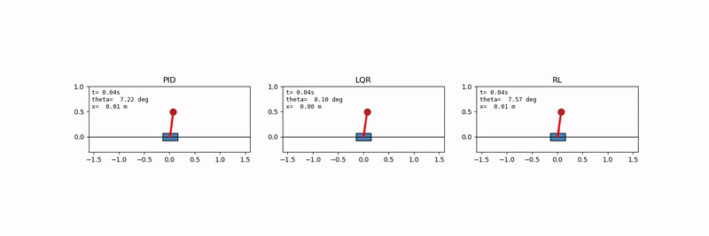
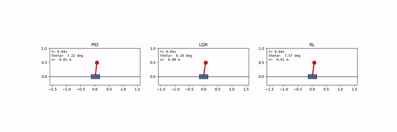

Inverted Pendulum, PID vs LQR vs RL

## 1. Problem statement

This submission covers the following deliverables:

- A mathematical/dynamic model of the inverted pendulum
- A PID implementation **with tuning methodology**
- An LQR implementation **with design methodology**
- An RL implementation **with training methodology**
- A common benchmark environment and test scenarios
- Comparative plots/tables for all three controllers
- Reproducible code

The evaluation criteria are stabilisation success, settling time, rise time,
overshoot, steady-state error, control effort, disturbance rejection, robustness
to model/parameter uncertainty, fairness/reproducibility of the comparison, and
**technical justification of every design/tuning choice**. This README documents
that justification, giving the reasoning behind each design decision along with
the final results.

**Key decisions and their rationale:**

- **Cart-pole configuration:** the system modelled is a cart-pole, which is the
  configuration described in the expected baseline of the problem statement.
- **Python as the implementation platform:** Python was chosen over
  MATLAB/Simulink so that PID, LQR and RL can be implemented in a single
  reproducible stack (NumPy/SciPy for the plant and classical controllers,
  Gymnasium + Stable-Baselines3/PyTorch for RL) that can be run end to end by
  the evaluator.
- **Complete documentation of RL development:** all three RL iterations are
  reported, including the failures observed in the earlier versions, together
  with an analysis of the cause of each. This gives a full account of how the
  final policy was obtained and where its limitations lie.

## 2. System description and mathematical model

- State vector: $s = [x, \dot{x}, \theta, \dot\theta]^T$, input
  $u = F$ (horizontal cart force), with $\theta = 0$ at the upright equilibrium.
- Parameters: $M$ (cart mass), $m$ (pendulum point mass), $l$ (pivot-to-mass
  length), $g$ (gravity).
- **Derivation:** the equations of motion were derived from first principles
  using the Euler-Lagrange method, with the kinetic energy of the cart and the
  pendulum point mass and the potential energy $mgl\cos\theta$.

**Coupled nonlinear equations of motion:**

$$(M + m)\ddot{x} + ml\ddot{\theta}\cos\theta - ml\dot{\theta}^2\sin\theta = F$$

$$l\ddot{\theta} + \ddot{x}\cos\theta - g\sin\theta = 0$$

**Explicit form for the accelerations** (as integrated in `dynamics.py`):

$$\ddot{x} = \frac{F + m\sin\theta\left(l\dot\theta^2 - g\cos\theta\right)}{M + m\sin^2\theta}$$

$$\ddot{\theta} = \frac{g\sin\theta - \ddot{x}\cos\theta}{l}$$

- **Integration method:** 4th-order Runge-Kutta (`rk4_step`) with a timestep of
  $dt = 0.005$ seconds, which gives better accuracy than Euler integration at the
  same step size.

**Linearization about the upright equilibrium** ($\theta, \dot\theta \to 0$,
$\sin\theta \approx \theta$, $\cos\theta \approx 1$, $\sin^2\theta \approx 0$).
The linear model is used **only** for LQR design. All simulations, including the
evaluation of LQR, use the nonlinear model above as the plant.

$$
A =
\begin{bmatrix}
0 & 1 & 0 & 0 \\
0 & 0 & -mg/M & 0 \\
0 & 0 & 0 & 1 \\
0 & 0 & (M+m)g/(Ml) & 0
\end{bmatrix}
$$

$$
B =
\begin{bmatrix}
0 \\
1/M \\
0 \\
-1/(Ml)
\end{bmatrix}
$$

### 2.1 Validity of the linearization

- The small-angle approximation was quantified (`validate_linearization.py`)
  using two checks:
  - An **instantaneous** acceleration mismatch check, which measures the
    modelling error due to the approximation alone, before the unstable dynamics
    cause the trajectories to diverge.
  - A **short-horizon (0.05 second)** free-response trajectory check.

| Initial angle | Instantaneous angular-acceleration error | Max trajectory error (0.05s) |
|---|---|---|
| 1 deg | 0.01% | 0.0000 deg |
| 2 deg | 0.03% | 0.0000 deg |
| 5 deg | 0.20% | 0.0003 deg |
| 10 deg | 0.81% | 0.0022 deg |
| 20 deg | 3.25% | 0.0174 deg |
| 40 deg | 13.10% | 0.1272 deg |

- **Significance:** the table gives the range of angles over which the
  linearization holds, which is relevant to the robustness to model uncertainty
  criterion. The error remains small in the regime where LQR operates, that is,
  small deviations from the upright position.

## 3. Controller design and tuning methodology

- **Common interface:** all three controllers use the identical interface
  `compute(state, x_ref, dt) -> force` and are evaluated through one shared
  harness (`simulation.py`) against the same nonlinear plant, so that the
  comparison between them is fair.

### 3.1 PID: cascaded architecture, systematically tuned

- **Architecture:** the outer loop maps cart-position error to a desired tilt
  angle (clamped to ±6 degrees), and the inner loop maps tilt-angle error to
  force (`controllers/pid.py`). A cascaded structure was chosen over a single
  SISO loop because the plant has two coupled objectives, angle *and* position.
- **Sign convention:** from the equations of motion,
  $\ddot\theta = a\theta - bu$ with $a, b > 0$. For stabilization, the inner
  loop's proportional gain must satisfy $K_{p,\text{angle}} > (M+m)g$
  (approximately 10.79 for the nominal parameters), otherwise the restoring force
  acts in the wrong direction. This constraint follows from the plant physics,
  and it was used directly as the lower bound of the tuning search.
- **Tuning method:** the gains were optimized using **differential evolution**
  (a global, derivative-free optimizer) against a fixed cost function that was
  defined before any results were evaluated:

$$\text{cost} = 1.0 \cdot t_s + 0.05 \cdot OS + 2.0 \cdot SSE + 0.0005 \cdot J_u$$

  where $t_s$ is settling time in seconds, $OS$ is overshoot in percent,
  $SSE$ is steady-state error in degrees, and $J_u$ is control effort (with
  $t_s$ replaced by $50 + SSE$ when the run never settles, so that the search
  is first directed toward stabilizing gains).

- **Weight ordering:** settling time carries the highest priority, since
  stabilization is the primary requirement. Steady-state accuracy, overshoot and
  control effort follow in that order.
- **Search bounds:** outer $K_p\in[0,0.5]$, $K_i\in[0,0.2]$,
  $K_d\in[0,0.5]$; inner $K_p\in[15,300]$ (lower bound set by the physics
  constraint above), $K_i\in[0,20]$, $K_d\in[0,60]$.
- **Optimization runs:** the first two tuning attempts converged to a local
  optimum (cost plateaued around 6.5 to 8.9). A third attempt with a larger
  population and a different seed converged to the reported gains.
- **Result** (initial tilt 8.5 degrees, full 6-second horizon): settling
  time 0.105s, overshoot 3.3%, steady-state error 0.014 degrees.

### 3.2 LQR: CARE-based, from the linearized model

- **Design:** the continuous-time algebraic Riccati equation
  (`scipy.linalg.solve_continuous_are`) is solved for the gain $K$ using $A$ and
  $B$ above, and full-state feedback $u = -K(s - s_{\text{target}})$ is applied,
  where $s_{\text{target}} = [x_{\text{ref}}, 0, 0, 0]$.
- **Weighting:** $Q = \text{diag}(1, 1, 10, 1)$, which penalizes angle error 10
  times more than position and velocity errors, since stabilising $\theta$ is
  the primary objective. $R = [0.05]$ applies a modest penalty on control effort.
- **Design parameters:** for a given $Q$ and $R$, the gain is the *unique*
  solution of the Riccati equation. The design therefore consists of choosing
  these two matrices, in contrast to PID, where six gains are tuned
  independently.

### 3.3 RL (PPO): environment, reward design, and a documented ablation

- **Environment:** a Gymnasium wrapper around the *same*
  `nonlinear_dynamics`/`rk4_step` used by PID and LQR, so that RL is trained on
  the identical plant (`rl_env.py`).
- **Observation:** $[x - x_{\text{ref}},\ \dot{x},\ \theta,\ \dot\theta]$. Because
  the observation is defined relative to the reference, RL solves the same
  reference-tracking problem as PID and LQR.
- **Action:** the action is normalized to the range $[-1, 1]$ and scaled to ±20
  Newtons inside the environment, which is standard practice for PPO and keeps
  the gradients well-scaled.
- **Training distribution:** only the initial condition is randomized per
  episode ($\theta_0$ within ±0.15 rad, $x_0$ within ±0.05 m, $x_{\text{ref}}$
  within ±0.2 m), with no disturbances and no parameter variation. The effect of
  this choice is discussed in Section 6.
- **Algorithm:** PPO (Stable-Baselines3) with `MlpPolicy`, a standard
  continuous-control baseline.

**Three RL versions were trained. All are reported, since the progression
between them explains the final behavior:**

- **v1:** 200k timesteps, raw reward
  $-(\theta^2 + 0.05(x-x_{\text{ref}})^2 + 0.001u^2)$ in physical Newtons, no
  observation normalization.
  - *Result:* did not settle reliably, even in the nominal case.
- **v2:** 500k timesteps, with `VecNormalize` added and the same reward.
  - *Result:* the policy settled, but slowly and with lower accuracy
    (steady-state error 0.363 deg vs PID's 0.014 deg), used very little control
    effort (max force 2.73N), and failed under the sustained disturbance and in
    most of the IC sweep.
  - **Diagnosis (reward scaling issue):** near the failure boundary ($\theta$
    approximately 0.42 rad, $u$ up to 20N), the effort penalty ($0.001u^2$, max
    0.4) could exceed the angle penalty ($\theta^2$, max approximately 0.175).
    The policy was therefore rewarded for reducing force rather than for
    correcting the angle.
- **v3:** the same 500k timesteps and the **same training distribution as v2**,
  with only the reward modified so that the effect of that change could be
  isolated:

$$r = -\left(10\theta^2 + 0.1\dot\theta^2 + 0.5(x-x_{\text{ref}})^2 + 0.05\dot{x}^2 + 0.01a^2\right) - 100 \cdot \mathbb{1}_{\text{fail}}$$

  - **Changes made:** the penalty is applied to the *normalized* action $a$
    instead of raw Newtons (removing its dependence on the force limit), explicit
    angular and linear velocity damping terms are added, and the failure penalty
    is raised from 20 to 100.
  - **Weight priority**, set before training and not adjusted afterward: angle
    stability > position tracking > control effort.
  - *Result:* see Section 5. Transient quality improved substantially, while the
    region-of-attraction limitation was not fully resolved.
- **v2 to v3 comparison:** the plant, algorithm, training distribution and
  evaluation protocol were kept the same and only the reward was changed, so the
  difference in results can be attributed to the reward. This is used in the
  analysis in Section 6.

## 4. Common benchmark methodology

- **Fairness:** `simulate()` in `simulation.py` is the single harness used for
  every controller. The nonlinear plant, RK4 integrator, timestep, actuator
  limit (±20N), initial condition and disturbance are identical for whichever
  controller is being tested.

**Metric definitions:**

- **Settling time:** the earliest time after which the response remains inside
  the tolerance band (the larger of 2% of the initial angle or 0.5 degrees) for
  the *remainder* of the run, and not only at the first instant it enters the
  band.
  - *Correction made during development:* the first implementation only checked
    the first crossing into the band, so a response that later moved back out of
    the band was still marked as settled. This was identified during testing and
    corrected before any results were recorded.
- **`decay_time_90_to_10_s`:** the time from the first crossing of 90% of the
  initial angular offset to the first crossing of 10% of it:
  $t_{90\to10} = t(|\theta| = 0.1|\theta_0|) - t(|\theta| = 0.9|\theta_0|)$.
  - **Naming:** this metric is not called rise time, because rise time is
    conventionally defined for a step response toward a nonzero setpoint,
    whereas here the response decays toward zero.
- **Overshoot:** the largest excursion to the opposite side of the initial tilt,
  expressed as a percentage of the initial tilt.
- **Steady-state error:** the mean $|\theta|$ over the last 1 second of the run.
- **Control effort:** $J_u = \int u^2\ dt$ over the run.
- **Max control force:** the largest $|u|$ used, which indicates whether the
  actuator saturates.

**Test scenarios**, all at an initial tilt of 8.5 degrees unless stated, with the
purpose of each:

- **Nominal:** no disturbance, 6-second horizon. This is the baseline case.
- **Impulse disturbance:** a single-timestep +5N force at t = 3s, which tests
  rejection of an instantaneous disturbance.
- **Sustained disturbance:** a +3N force held from t = 3.0s to t = 3.5s, which
  tests rejection of a disturbance that persists for a period of time.
- **Initial-condition sweep:** initial tilt in {2, 5, 8.5, 10, 12, 15, 20}
  degrees with no disturbance. This shows the range of initial tilt over which
  each controller stabilizes the pendulum, in addition to its speed at a single
  point.
- **Parameter uncertainty:** 15 trials, with $M$, $m$, $l$ each
  independently perturbed by up to ±15%, while every controller's
  gains/policy are computed **once**, at nominal parameters, and are not
  redesigned per trial.
  - **Rationale for fixed controllers:** redesigning for each trial would only
    test retuning for a known plant. Keeping the controllers fixed tests whether
    a controller designed for the nominal system still performs when the actual
    parameters differ from it.

## 5. Results

### 5.1 Nominal (initial tilt 8.5 degrees)

| Metric | PID | LQR | RL (v3) |
|---|---|---|---|
| Settling time | 0.105 s | 1.380 s | FAIL (nan) |
| Decay time (90 to 10%) | 0.070 s | 0.210 s | 0.295 s |
| Overshoot | 3.28% | 32.01% | 10.45% |
| Steady-state error | 0.014 deg | 0.021 deg | 0.543 deg |
| Control effort | 41.33 | 2.98 | 6.54 |
| Max force | 20 N | 8.28 N | 20 N |


### 5.2 Impulse disturbance (+5N at t=3s)

| Metric | PID | LQR | RL (v3) |
|---|---|---|---|
| Settling time | 0.105 s | 1.380 s | FAIL (nan) |
| Overshoot | 3.28% | 32.01% | 10.45% |
| Steady-state error | 0.014 deg | 0.017 deg | 0.544 deg |
| Control effort | 41.55 | 3.11 | 6.71 |


### 5.3 Sustained disturbance (+3N, t=3.0 to 3.5s)

| Metric | PID | LQR | RL (v3) |
|---|---|---|---|
| Settling time | 3.530 s | 4.800 s | FAIL (nan) |
| Overshoot | 8.91% | 34.57% | 10.45% |
| Steady-state error | 0.091 deg | 0.175 deg | 0.616 deg |
| Control effort | 42.49 | 4.25 | 6.68 |


- PID and LQR both recover from the disturbance.
- RL does not diverge in this case (the earlier v2 policy did, see Section 6),
  but it does not meet the settling criterion.

### 5.4 Initial-condition sweep

| Initial tilt | PID | LQR | RL (v3) |
|---|---|---|---|
| 2 deg | 0.05 s | 0.88 s | **0.23 s** |
| 5 deg | 0.08 s | 1.25 s | **0.32 s** |
| 8.5 deg | 0.10 s | 1.38 s | FAIL |
| 10 deg | 0.12 s | 1.42 s | FAIL |
| 12 deg | 0.19 s | 1.45 s | FAIL |
| 15 deg | 2.35 s | 2.81 s | FAIL |
| 20 deg | 3.64 s | 3.25 s | FAIL |

- PID is **not** faster than LQR in every case. At 20 degrees, LQR settles
  faster (3.25s vs 3.64s).
- RL is faster than both classical controllers at 2 and 5 degrees, but does not
  settle from 8.5 degrees upward.

### 5.5 Parameter uncertainty (15 trials, ±15% on M, m, l)

| Controller | Settling time | Failures | Overshoot |
|---|---|---|---|
| PID | 0.128 ± 0.029 s | 0/15 | 4.86 ± 2.40% |
| LQR | 1.382 ± 0.054 s | 0/15 | 32.40 ± 2.25% |
| RL (v3) | N/A (all failed) | 15/15 | 10.47 ± 0.07% |

### 5.6 Simulation videos

- The clips were generated with `make_simulation_video.py`, using the same plant
  and controller code as the benchmark above.
- Each clip shows PID, LQR and RL side by side with a live time/angle/position
  readout, at the same 8.5-degree initial tilt used throughout Section 5.
- The clips are embedded below as GIFs, because GitHub's README renderer does
  not display `<video>` tags. The original `.mp4` files are available in
  `results/` at full quality.

**Nominal (no disturbance):**



**Sustained disturbance** (+3N push at t = 3.0 to 3.5s). The recovery of PID and
LQR can be seen in real time, along with the behavior of RL over the same window:



Full-quality MP4 versions:
[nominal](results/simulation_video_nominal.mp4) |
[sustained disturbance](results/simulation_video_sustained_disturbance.mp4)

## 6. Discussion

**Fast transient decay versus successful stabilization**

- RL's decay time (0.295s) is comparable to PID and its overshoot (10.45%) is
  lower than LQR's, but it does not meet the settling criterion.
- Its steady-state error (0.543 deg) is slightly above the 0.5-degree tolerance
  band, and the maximum force remains saturated at 20N late into the run.
- This behavior indicates chattering at the boundary and not divergence: the
  policy applies full force to a very small residual error instead of reducing
  it gradually. This is consistent with the low effort-penalty weight (0.01),
  which keeps a full-force correction inexpensive even for a small error.

**Region of attraction of the RL policy**

- The IC sweep shows this most clearly: RL settles fastest of the three
  controllers at 2 and 5 degrees, and fails from 8.5 degrees upward.
- The policy is functional, but its verified stabilizing region is narrower than
  that of PID and LQR under the nominal-only training distribution used here.

**Effect of the reward change (v2 to v3)**

- With only the reward modified (same plant, algorithm and training
  distribution), RL went from never settling, low actuator usage (max 2.73N) and
  43.6% overshoot, to using the full actuator range with an overshoot of 10.45%.
- Transient quality improved while the region-of-attraction limitation remained.
  This suggests two partly separate causes: reward *scaling* limited actuator
  use, while the *training distribution* (initial-condition randomization only,
  with no disturbances and no parameter variation) is the more likely reason for
  the narrow generalization.

**Summary**

- **PID** (systematically tuned): the fastest and most accurate controller, with
  high control effort and frequent actuator saturation.
- **LQR**: slower to settle in most cases and considerably lower in control
  effort, and faster than PID at the largest tested tilt (20 degrees).
- **RL (PPO):** fast local recovery for small deviations, but a narrow region of
  attraction and no robustness to disturbances or parameter uncertainty under
  this training distribution. This limitation was diagnosed and partly addressed
  through the controlled reward ablation.

## 7. Limitations

- **RL version:** RL training was stopped at v3 because of time constraints. The
  next experiment would be a v4 trained *with* disturbances and randomized $M$,
  $m$, $l$, $\theta_0$, $x_0$, and evaluated on unseen combinations. This tests a
  different hypothesis (coverage of the training distribution) from the v2 to v3
  reward change, so it is kept as a separate study and has not been combined
  with it here.
- **PID actuator saturation:** PID reaches the 20N limit routinely. This is the
  cost of its speed advantage and is visible in the tables above.
- **Hardware validation:** no physical hardware validation was carried out, as
  it is outside the scope of the general requirements (hardware fabrication and
  PCB design are explicitly not required).

## 8. Reproducibility

All results reported here (plots in `results/`, `ppo_cartpole.zip`,
`vecnormalize.pkl`) are already generated and included in the repository, so
re-running or retraining is **not required** to reproduce them. The steps below
are provided for verifying reproducibility or extending the work.

### Setup

```bash
python3 -m venv venv
source venv/bin/activate        # Windows: venv\Scripts\activate
pip install -r requirements.txt
```

### Run

1. Validate the linearization used for LQR design:
```bash
   python3 validate_linearization.py
```
2. (Already run, included for reproducibility) Systematic PID tuning:
```bash
   python3 tune_pid.py
```
   The resulting gains have already been copied into `run_benchmark.py`.
3. (Optional, needs internet access) Retrain RL:
```bash
   pip install gymnasium stable-baselines3 torch
   python3 train_rl.py
```
   This saves `ppo_cartpole.zip` and `vecnormalize.pkl`, which are required
   together (see `controllers/rl.py`).
4. Run the full benchmark (PID and LQR always; RL as well if the two files above
   are present and stable-baselines3/torch are installed):
```bash
   python3 run_benchmark.py
```
   This prints every table in Section 5 and regenerates the plots in `results/`.

### Structure

```
parameters.py                # plant parameters (M, m, l, g, dt)
dynamics.py                  # nonlinear dynamics, linear A/B, RK4 integrator
validate_linearization.py    # nonlinear-vs-linear validation (Section 2.1)
simulation.py                # shared benchmark harness (Section 4)
metrics.py                   # settling time, decay_time_90_to_10_s, etc. (Section 4)
tune_pid.py                  # systematic PID gain search (Section 3.1)
rl_env.py                    # Gymnasium env wrapping the same nonlinear plant (Section 3.3)
train_rl.py                  # PPO training script, v1/v2/v3 lineage documented inline
ppo_cartpole.zip             # trained PPO model (v3)
vecnormalize.pkl             # observation-normalization stats for v3 (required alongside it)
controllers/
    pid.py                   # cascaded PID
    lqr.py                   # CARE-based LQR
    rl.py                    # loads the trained PPO model + normalization stats
run_benchmark.py             # runs every scenario in Section 4, saves plots to results/
results/                     # the three plots embedded in Section 5
```
